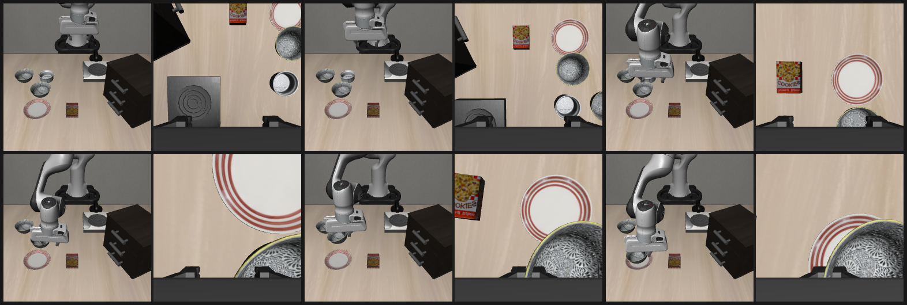
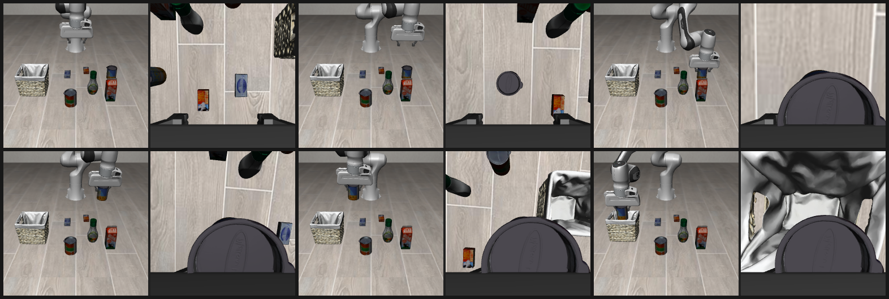
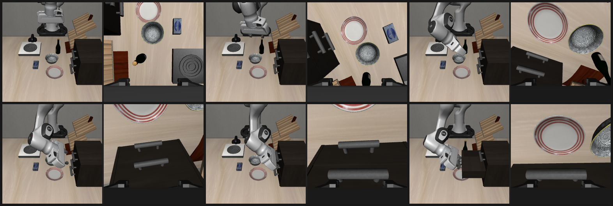
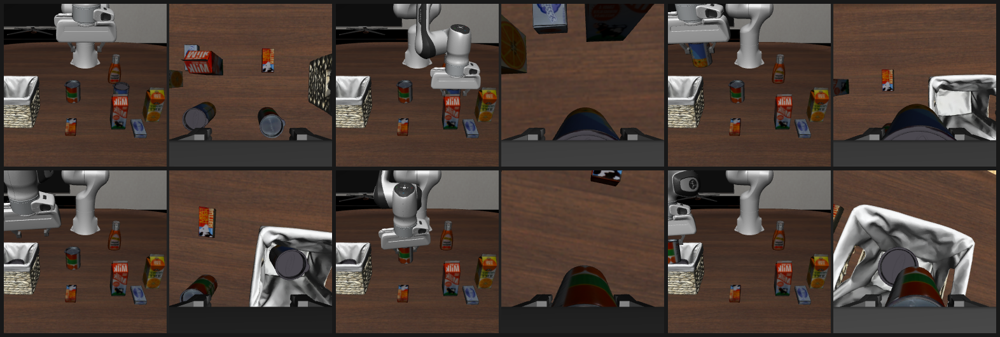

# LIBERO-RSI-Bench: Imitation Learning (ACT) Visual Rollout Showcase

Each rollout frame displays synchronized dual-camera RGB views: **Left = `agentview` (3rd-person workspace camera)** | **Right = `robot0_eye_in_hand` (wrist camera)**.

## Spatial (spatial_t0): Pick Black Bowl -> Place on Plate
- **Episode**: `dev_000` (`split=dev`, `ood_axis=none`)
- **Instruction**: *"pick up the black bowl between the plate and the ramekin and place it on the plate"*
- **Outcome**: **SUCCESS (1.0x)** in **80 steps**
- **Simulation Video (H.264 MP4)**: [`videos/spatial_t0_dev_000_success.mp4`](videos/spatial_t0_dev_000_success.mp4)
- **Animated Rollout (GIF)**: [`gifs/spatial_t0_dev_000_success.gif`](gifs/spatial_t0_dev_000_success.gif)
- **6-Stage Trajectory Filmstrip (0% -> 20% -> 40% -> 60% -> 80% -> 100%)**:
  

## Object (object_t0): Pick Alphabet Soup -> Place in Basket
- **Episode**: `dev_025` (`split=dev`, `ood_axis=none`)
- **Instruction**: *"pick up the alphabet soup and place it in the basket"*
- **Outcome**: **SUCCESS (1.0x)** in **126 steps**
- **Simulation Video (H.264 MP4)**: [`videos/object_t0_dev_025_success.mp4`](videos/object_t0_dev_025_success.mp4)
- **Animated Rollout (GIF)**: [`gifs/object_t0_dev_025_success.gif`](gifs/object_t0_dev_025_success.gif)
- **6-Stage Trajectory Filmstrip (0% -> 20% -> 40% -> 60% -> 80% -> 100%)**:
  

## Goal (goal_t0): Articulate & Open Middle Cabinet Drawer
- **Episode**: `dev_050` (`split=dev`, `ood_axis=none`)
- **Instruction**: *"open the middle drawer of the cabinet"*
- **Outcome**: **SUCCESS (1.0x)** in **124 steps**
- **Simulation Video (H.264 MP4)**: [`videos/goal_t0_dev_050_success.mp4`](videos/goal_t0_dev_050_success.mp4)
- **Animated Rollout (GIF)**: [`gifs/goal_t0_dev_050_success.gif`](gifs/goal_t0_dev_050_success.gif)
- **6-Stage Trajectory Filmstrip (0% -> 20% -> 40% -> 60% -> 80% -> 100%)**:
  

## Long-Horizon (long_t0): Put Both Alphabet Soup & Tomato Sauce in Basket
- **Episode**: `dev_075` (`split=dev`, `ood_axis=none`)
- **Instruction**: *"put both the alphabet soup and the tomato sauce in the basket"*
- **Outcome**: **SUCCESS (1.0x)** in **256 steps**
- **Simulation Video (H.264 MP4)**: [`videos/long_t0_dev_075_success.mp4`](videos/long_t0_dev_075_success.mp4)
- **Animated Rollout (GIF)**: [`gifs/long_t0_dev_075_success.gif`](gifs/long_t0_dev_075_success.gif)
- **6-Stage Trajectory Filmstrip (0% -> 20% -> 40% -> 60% -> 80% -> 100%)**:
  

